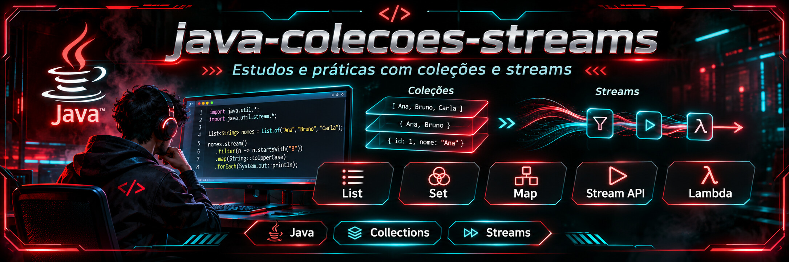
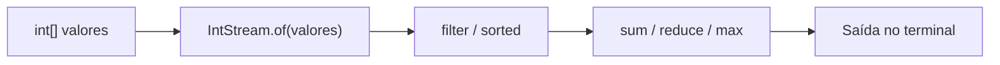

<div align="center">
  
</div>

<div align="center">

# J A V A　//　C O L E Ç Õ E S　&　S T R E A M S

### `ARRAYS • COLLECTIONS • INTSTREAM • REDUCE`

**Exercícios práticos para estudar estruturas de dados e processamento de coleções em Java.**


`FATEC • ADS`　·　`JAVA CORE`　·　`LAB DE ESTUDOS`

[Visão geral](#visao-geral) · [Exercícios](#exercicios) · [Fluxo](#fluxo) · [Execução](#execucao)

</div>

---

<a id="visao-geral"></a>

## `PROJECT // VISÃO GERAL`

Este repositório reúne **três programas Java independentes**, cada um com seu próprio método `main`. O foco é estudar diferenças entre **arrays, listas imutáveis, listas mutáveis e operações de Stream**.

Não é uma API, um framework ou uma aplicação com banco de dados: os exercícios rodam diretamente no terminal e exibem resultados com `System.out`.

<a id="exercicios"></a>

## `CORE // LABORATÓRIO DE EXERCÍCIOS`

| Arquivo | O que demonstra |
| :--- | :--- |
| [`Sample01.java`](src/Sample01.java) | `List.of()`, `ArrayList`, adição, remoção e `for-each` |
| [`Sample02.java`](src/Sample02.java) | Soma de valores de um array usando `for` e índice |
| [`Samples03.java`](src/Samples03.java) | `IntStream.of()`, `sorted()`, `forEach()`, `min()`, `max()`, `sum()`, `reduce()` e `filter()` |

### `SYSTEM // CONCEITOS`

| Elemento | Papel |
| :--- | :--- |
| `List.of()` | Cria lista que não admite modificações |
| `ArrayList` | Lista mutável: `add()` / `remove()` |
| `for` e `for-each` | Percorrem arrays e coleções |
| `IntStream` | Processa sequências de inteiros |
| `filter()` | Seleciona elementos que atendem a uma condição |
| `sorted()` | Ordena elementos |
| `reduce()` | Consolida valores em um resultado |
| `sum()`, `min()`, `max()` | Operações numéricas de agregação |

<a id="fluxo"></a>

## `ARCHITECTURE // PIPELINE DIDÁTICO`



> O fluxograma resume os conceitos do terceiro exercício, não representa uma arquitetura única para todos os arquivos.

## `STRUCTURE // ORGANIZAÇÃO`

```text
java-colecoes-streams/
├── src/
│   ├── Sample01.java
│   ├── Sample02.java
│   └── Samples03.java
└── README.md
```

<a id="execucao"></a>

## `BOOT SEQUENCE // EXECUTAR NO LINUX`

**Pré-requisito:** JDK com os comandos `javac` e `java`.

```bash
git clone https://github.com/gilbertocorrea-cmd/java-colecoes-streams.git
cd java-colecoes-streams
mkdir -p out
javac -d out src/*.java
```

Escolha **um exemplo por vez**:

```bash
java -cp out Sample01
java -cp out Sample02
java -cp out Samples03
```

O último arquivo tem o nome exato **`Samples03.java`**, com `s` antes de `03`.

---

<div align="center">

### `JAVA STREAM PIPELINE // FILTER • MAP • REDUCE`

**Gilberto Corrêa** · Análise e Desenvolvimento de Sistemas — FATEC

[GitHub](https://github.com/gilbertocorrea-cmd)

</div>
